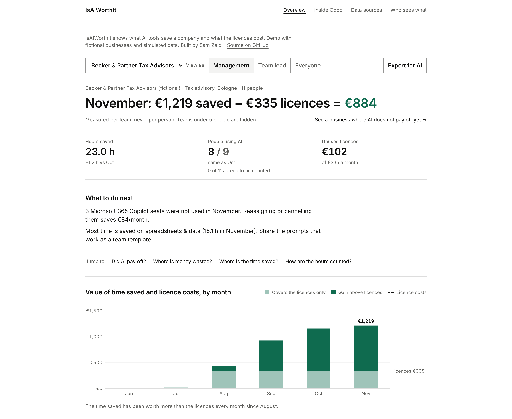
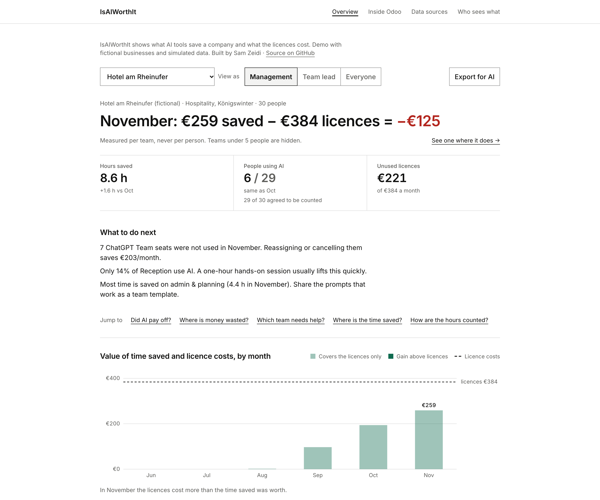
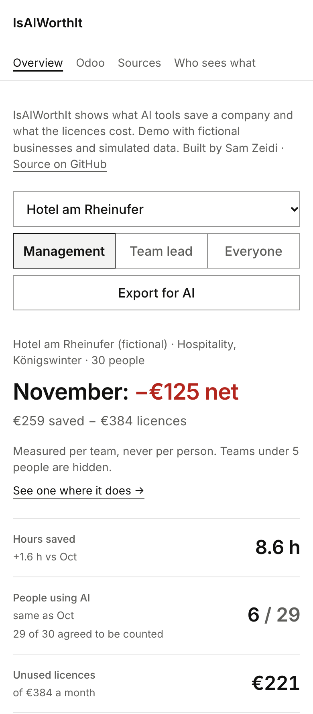
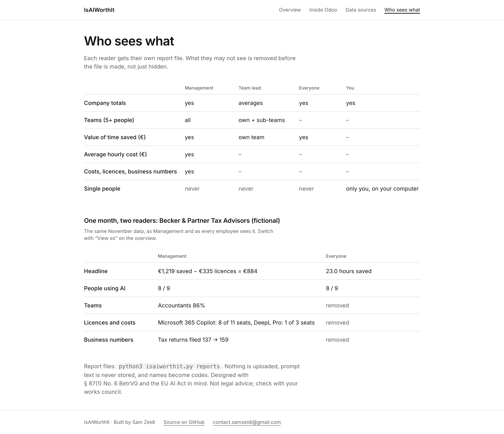
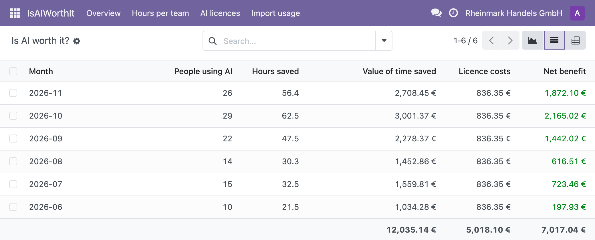
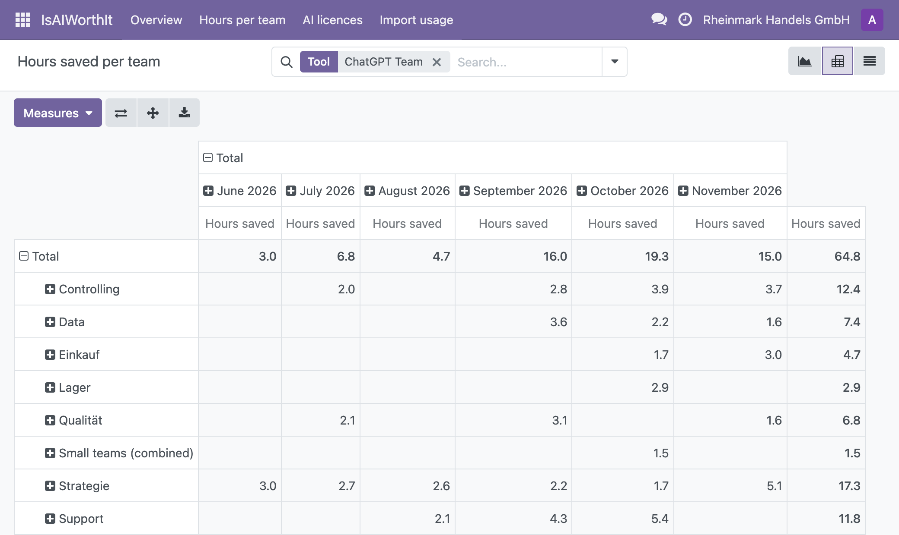

# IsAIWorthIt

**Live demo: [samaistudio.github.io/IsAIWorthIt](https://samaistudio.github.io/IsAIWorthIt/)** · [Guided tour](https://samaistudio.github.io/IsAIWorthIt/tutorial/) · [Example report for staff](https://samaistudio.github.io/IsAIWorthIt/tutorial/example-report-everyone.html)

### Shows a small business what its AI tools save and what the licences cost. Runs on its own or inside Odoo 18.

Built by Sam Zeidi ([contact.samzeidi@gmail.com](mailto:contact.samzeidi@gmail.com)).



**What is in this repository**

- **Odoo 18 module** (`odoo_module/isaiworthit`): its own app with two access groups (Viewer, Manager), money fields only managers can read, multi-company record rules, a usage import wizard, a pivot per department, and tests for Odoo's test runner.
- **Odoo external-API connector** that reads departments, employees, booked hours and monthly business counts.
- **CSV and API connectors** for Microsoft 365 Copilot, GitHub Copilot, Anthropic and Personio, each marked *tested* or *built from vendor docs*.
- **Privacy rules in the code:** groups of 5 or more only, opt-in, and a separate report file per reader with restricted data removed.
- **Read-only MCP server**, so Claude, Cursor or Copilot can answer "did AI pay off in October?".
- **React + TypeScript dashboard**, compiled into one HTML file, so users only need Python.

```text
connectors (Odoo, CSV, APIs) ──> local SQLite ──> JSON per business ──┬──> dashboard (web/index.html)
                                                                      ├──> report files, one per reader
                                                                      └──> MCP server for AI assistants
Odoo module: the same measurement inside Odoo, with its own import and access rights
```

## Try it in one minute

You need Python 3.10 or newer. No packages, no accounts.

```bash
git clone https://github.com/samaistudio/IsAIWorthIt
cd IsAIWorthIt
python3 isaiworthit.py
```

Your browser opens the dashboard with **10 fictional demo businesses**: a tax office, a dental practice, a marketing agency, an electrician, a hotel and more. Pick one from the menu at the top left.

## What you see

- **The answer in one line**: value of the time saved minus the AI licence costs, for the latest month.
- **Three numbers**: hours saved, people using AI (of those who agreed to be counted), money spent on unused seats.
- **What to do next**: two or three plain steps, such as cancelling unused seats or training a team.
- **By month**: value of the time saved against the dashed licence line.
- **Licences, teams, tasks**: seats bought vs. used, adoption per team (5+ people only), and where the time is saved.
- **How the hours are calculated**, and for Management **Try another hourly cost**, so every number can be checked.
- **View as** Management, Team lead or Everyone, and **Export for AI** (copy as text, Markdown or JSON).

Not every business wins. The demo hotel loses money on AI this month because more than half of its licences sit unused. The tool says so.



On a phone the result comes first:



## How the hours are calculated

No tool measures saved time directly, so IsAIWorthIt estimates it in two steps:

1. **Benchmarks**: minutes saved per AI action, for example 6 min per ChatGPT request, 15 min per Microsoft 365 Copilot day, 30 min per GitHub Copilot day. These are starting assumptions set in `core/measure.py`, not measured values. Change them under `company.benchmarks` in the config.
2. **Survey**: one anonymous question a month ("About how much time did AI save you this week?"). With 5 or more answers, the benchmark estimate is scaled to match (limited to 0.25× to 4×). See [docs/SURVEY.md](docs/SURVEY.md).

Value of time saved = hours saved × average hourly staff cost. Net benefit = value − licence costs.

## Use your own data

Every connector is optional and off by default.

```bash
python3 isaiworthit.py init      # creates isaiworthit.config.json; switch on what you use
python3 isaiworthit.py sync      # reads the enabled sources into a local database
python3 isaiworthit.py           # your company now appears in the dashboard menu
```

Sources include Odoo, CSV exports (any AI tool, team list, KPIs, survey), Microsoft 365 Copilot, GitHub Copilot, Personio and Claude Code. The full list with status is in [docs/CONNECTORS.md](docs/CONNECTORS.md). Secrets are read from environment variables, never from the config file. Names and e-mail addresses are replaced by a salted code before anything is stored.

## Who sees what

```bash
python3 isaiworthit.py reports   # one file per reader, set in isaiworthit.config.json under "access"
```

| What | Management | Team lead | Everyone | You |
|---|---|---|---|---|
| Company totals (hours, people using AI) | yes | averages | yes | yes |
| Value of time saved (€, at the average hourly cost) | yes | own team | yes | – |
| Average hourly cost (€) | yes | – | – | – |
| Teams (5+ people) | all | own team + sub-teams | – | – |
| Licence costs, net benefit, business numbers | yes | – | – | – |
| Single people | never | never | never | only you, on your own computer |

Each report is written as `.html` (open in any browser) and `.md`. Data a reader may not see is removed before the file is made, not just hidden. Team reports are not made for teams under 5 people.



## Odoo module

`odoo_module/isaiworthit` is an Odoo 18 app. It depends only on *Employees* and is tested on Odoo 18 Community (not on Enterprise).



- **Import usage**: a CSV export (`date, user, tool, uses, minutes`, comma or semicolon) from Microsoft 365, GitHub Copilot, ChatGPT Team or a shared sheet, plus the optional monthly survey. Users are matched to employees by work e-mail only to find their department; nothing is stored per person.
- **Results**: net benefit per month, and a pivot of hours saved per department and tool. Departments with fewer than 5 people are combined.
- **Two groups**: *Viewer* sees hours per team; *Manager* also sees money, licences and the import.
- **German included**: `i18n/de.po` plus a `.pot` template for other languages.

Try it with Docker (Odoo on port 8069, so stop any other local Odoo first):

```bash
docker compose -f odoo/docker-compose.yml up -d        # http://localhost:8069, then install IsAIWorthIt under Apps
docker compose -f odoo/docker-compose.yml run --rm odoo \
  odoo -d iaw_test -i isaiworthit --test-enable --test-tags /isaiworthit --stop-after-init   # module tests
```

The screenshots come from a local Odoo 18 Community with test data for the fictional Rheinmark Handels GmbH, so the numbers differ from the dashboard demo. More in the [module README](odoo_module/isaiworthit/README.md).



## MCP server: ask your AI assistant

`python3 isaiworthit.py mcp` starts a read-only [Model Context Protocol](https://modelcontextprotocol.io) server (standard library only). Add it to Claude Desktop, Claude Code, Cursor or any MCP client:

```json
{
  "mcpServers": {
    "isaiworthit": {
      "command": "python3",
      "args": ["/path/to/IsAIWorthIt/isaiworthit.py", "mcp"]
    }
  }
}
```

Tools: `list_businesses`, `get_report`, `get_month`, `compare_months`, `how_it_measures`, `licence_check`. By default it serves the **everyone** view (no costs, no teams). Add `"--view", "management"` to the args for costs and licences, only on the managers' own computers.

## Privacy by design

- **Runs on your own computer.** Nothing is uploaded. Prompt content is never stored, only counts and time estimates.
- **No individual tracking.** No numbers for single employees. Teams with fewer than 5 people are hidden.
- **Opt-in.** Only people who agreed are counted.
- **Designed with § 87(1) No. 6 BetrVG and the EU AI Act in mind.** Not legal advice; check with your works council.

A company that uses IsAIWorthIt on its employees' data is responsible for doing so lawfully: in Germany that means GDPR and, where one exists, agreement with the works council.

## Known limits

- **Estimates, not measurements.** Hours saved come from benchmarks and a survey, not from timing anyone.
- **Hidden teams can be worked out.** If a company has two teams and one is hidden, the hidden team's hours are the company total minus the shown team (for example 23.0 h − 18.4 h at the demo tax office). Share team numbers with care in very small companies.
- **Odoo: the 5-person rule applies to departments.** A department of 5 or more where only one or two people use a certain tool can still show a small cell in the pivot.
- **Odoo: users not matched to an employee** are grouped as one row ("Not matched to an employee") regardless of size; keep the usage file to employees.
- **Odoo: licence costs use today's prices.** Every imported month uses the seats and prices set under *AI licences* at import time.
- **Team view in the demo:** only the latest month is the team's own number; earlier months are estimated from its share of headcount (drawn as outlines).
- **Some connectors are untested against live accounts:** Microsoft 365, GitHub Copilot, the Anthropic Admin API and Personio are built from the vendors' documentation.

## Status

Version 0.2.0. Tested end to end against a local Odoo 18 Community: the dashboard, the Odoo connector and module, the MCP server, and the CSV and Claude Code connectors. Automated tests: `python3 -m unittest discover -s tests -t .` (standard library) and the Odoo module tests above. Developer notes: [docs/DEVELOPING.md](docs/DEVELOPING.md).

## Demo data

All ten demo businesses, Rheinmark Handels GmbH, their people and their numbers are invented. Any resemblance to real companies or persons is coincidental.

## License

Apache-2.0, see [LICENSE](LICENSE). Copyright 2026 Sam Zeidi. Third-party parts and their licences: [THIRD_PARTY_NOTICES.md](THIRD_PARTY_NOTICES.md).
